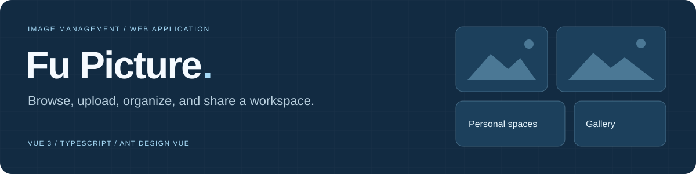
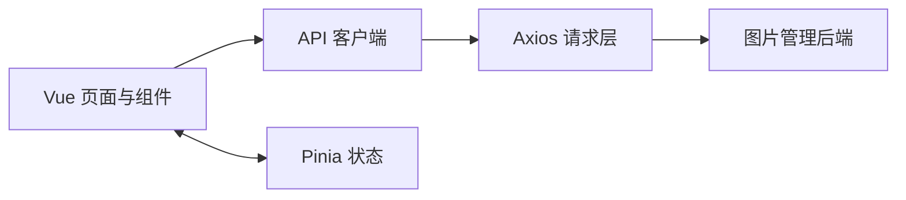

# Fu Picture Frontend



**Vue 3 + TypeScript 图片管理应用前端，包含图库、上传、空间与管理页面。**

[页面路由](src/router/index.ts) · [请求层](src/request.ts) · [API 客户端](src/api/) · [配套后端](https://github.com/dailyun/fu-picture-backend)

这是图片管理应用的前端工程，使用 Ant Design Vue、Pinia 和 Vite。它依赖配套后端提供登录态、图片和空间数据，不是一个独立的静态图库服务。

## 页面与功能

| 使用场景 | 页面入口 | 代码 |
| --- | --- | --- |
| 浏览、搜索、按分类和标签筛选 | `/` | [HomePage](src/pages/HomePage.vue) |
| 登录与注册 | `/user/login`、`/user/register` | [用户页面](src/pages/user/) |
| 上传、创建图片 | `/add_picture` | [AddPicturePage](src/pages/AddPicturePage.vue) |
| 批量创建图片 | `/add_picture/batch` | [AddPictureBatchPage](src/pages/AddPictureBatchPage.vue) |
| 查看图片详情 | `/picture/:id` | [PictureDetailPage](src/pages/PictureDetailPage.vue) |
| 创建与查看空间 | `/add_space`、`/my_space`、`/space/:id` | [SpaceDetailPage](src/pages/SpaceDetailPage.vue) |
| 用户、图片、空间管理 | `/admin/userManage` 等 | [管理页面](src/pages/admin/) |

## 数据怎样进入页面



## 本地运行

使用 Node.js 22 与 npm。先启动并配置配套后端，再启动前端。

```bash
git clone https://github.com/dailyun/fu-picture-frontend.git
cd fu-picture-frontend
npm ci
npm run dev
```

打开 Vite 在终端输出的本地地址。当前 [src/request.ts](src/request.ts) 使用 `http://localhost:8123` 作为请求基址，并启用 `withCredentials`；如果后端地址不同，需要调整请求层，后端也需要正确配置跨域和会话 Cookie。

## 开发命令

| 命令 | 用途 |
| --- | --- |
| `npm run dev` | 启动开发服务器 |
| `npm run type-check` | 用 vue-tsc 检查类型 |
| `npm run build` | 类型检查和生产打包 |
| `npm run build-only` | 仅执行 Vite 打包 |
| `npm run preview` | 本地预览构建产物 |
| `npm run lint` | ESLint 检查并自动修复文件 |
| `npm run format` | 格式化 src 目录 |
| `npm run openapi` | 按 openapi.config.js 重新生成 API 客户端 |

运行 lint、format 或 openapi 后检查 Git diff，它们可能修改现有文件。API 生成之前，先核对后端 schema 地址。

## 阅读路线

从 [路由](src/router/index.ts)找页面，再查看 [src/pages](src/pages/)、[组件](src/components/)和 [stores](src/stores/)。请求统一经过 [src/request.ts](src/request.ts)，接口调用封装在 [src/api](src/api/)。

## English overview

A Vue 3 and TypeScript frontend for an image-management application, with a searchable gallery, upload flows, image details, spaces, and administration pages. It uses Ant Design Vue, Pinia, Axios, and Vite, and requires the companion backend for authentication and data. See the route map and request layer above before adapting it to your own deployment.
